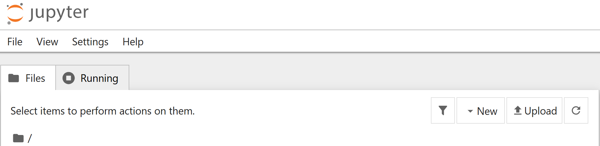
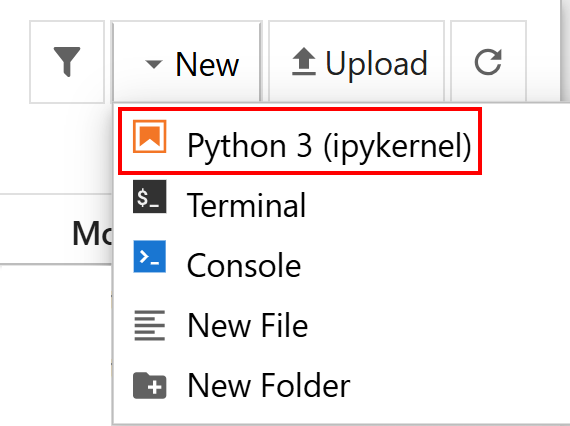
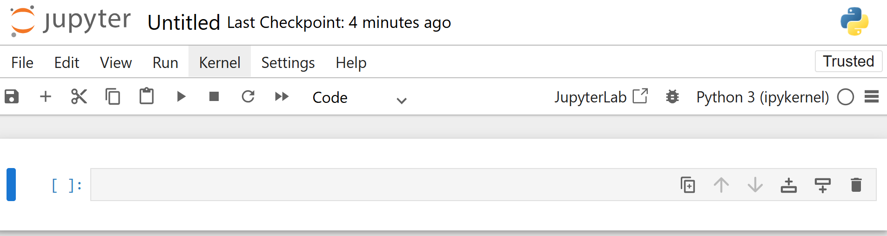
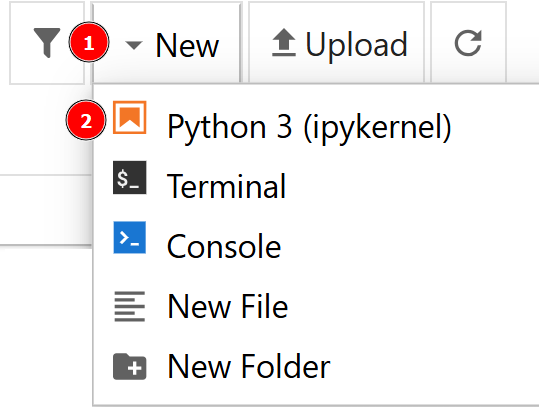
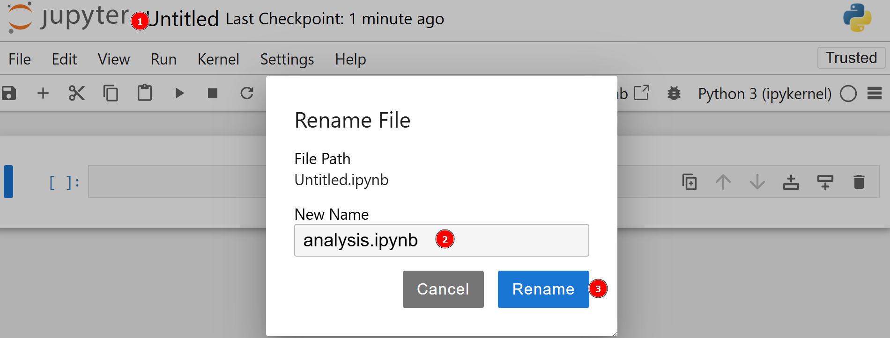
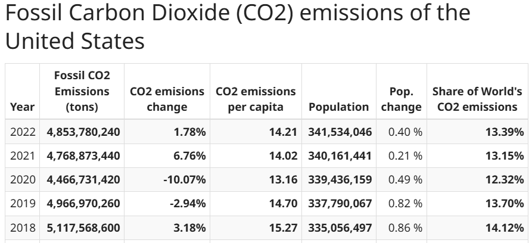
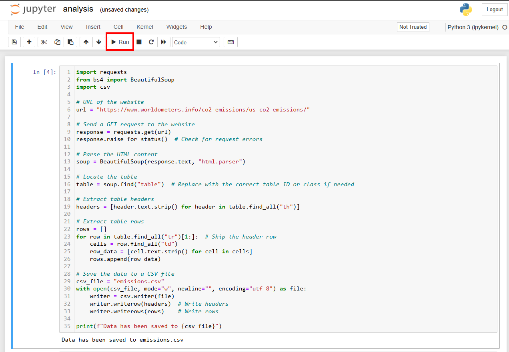
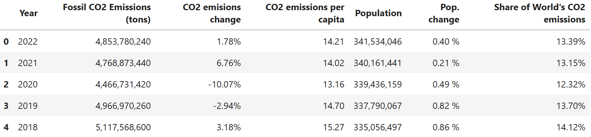
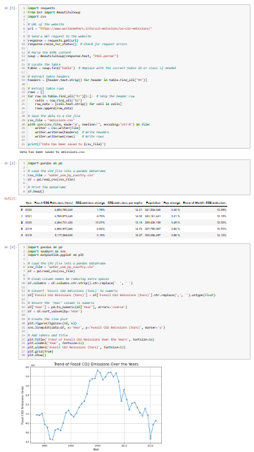

# 使用 Jupyter Notebooks 进行网页爬虫

[](https://www.bright.cn/) 

本指南介绍如何使用 Jupyter Notebooks，通过交互式编程、数据分析和可视化进行网页爬虫。

- [什么是 Jupyter Notebooks？](#什么是-jupyter-notebooks)
- [为什么使用 Jupyter Notebooks 进行网页爬虫？](#为什么使用-jupyter-notebooks-进行网页爬虫)
- [如何使用 Jupyter Notebooks 进行网页爬虫](#如何使用-jupyter-notebooks-进行网页爬虫)
  - [第 1 步：设置环境并安装依赖项](#第-1-步设置环境并安装依赖项)
  - [第 2 步：定义目标页面](#第-2-步定义目标页面)
  - [第 3 步：检索数据](#第-3-步检索数据)
  - [第 4 步：确保数据正确](#第-4-步确保数据正确)
  - [第 5 步：可视化数据](#第-5-步可视化数据)
  - [第 6 步：整合所有内容](#第-6-步整合所有内容)
- [Jupyter Notebook 网页爬虫的应用场景](#jupyter-notebook-网页爬虫的应用场景)
- [总结](#总结)

## 什么是 Jupyter Notebooks？

Jupyter Notebook App 是一种服务器-客户端应用程序，可通过网页浏览器编辑和运行[笔记本文档](https://jupyter-notebook-beginner-guide.readthedocs.io/en/latest/what_is_jupyter.html#notebook-document)。Jupyter [笔记本](https://docs.jupyter.org/en/latest/)是“一种可共享的文档，它将计算机代码、自然语言描述、数据、图表、图形、示意图以及交互式控件结合在一起”。你可以将 Notebook 应用程序作为桌面应用运行，也可以将其安装在远程服务器上。



Jupyter Notebooks 围绕“内核”构建，这是一种负责执行 Notebook 文档中代码的计算引擎。具体而言，`ipython` 内核运行 Python 代码，同时也有适用于其他语言的内核。



该应用的控制面板支持显示本地文件、打开现有 Notebook 文档、管理文档内核等常见操作：



## 为什么使用 Jupyter Notebooks 进行网页爬虫？

Jupyter Notebooks 的一些设计特性使其非常适合[网页爬虫](https://www.bright.cn/blog/how-tos/what-is-web-scraping)：

- **交互式开发**：以称为单元格的小型、易管理代码块编写和执行代码。每个单元格均可独立运行，从而简化测试和调试。
- **结构化文档**：在单元格中使用 Markdown 记录代码、解释逻辑并提供备注或说明。  
- **无缝集成数据分析**：使用 `pandas`、`matplotlib`、`seaborn` 等 Python 库，立即处理和分析抓取的数据。
- **可复现与共享**：轻松将 Jupyter Notebooks 作为 `.ipynb` 文件共享，或将其转换为 [ReST](https://docutils.sourceforge.io/rst.html)、Markdown 等格式。

### 优缺点

以下是使用 Jupyter Notebooks 抓取数据的优缺点：

#### **优点**

- **分步调试**：每个单元格均可独立运行，因此你可以将数据提取代码拆分为较小的部分。这样便能单独运行各个单元格并精确定位问题，让调试变得更轻松。  
- **全面的文档记录**：在单元格中使用 Markdown 记录爬虫代码、解释其功能并说明设计决策的依据。  
- **灵活性**：Jupyter Notebooks 可在单一环境中无缝整合网页爬虫、数据清洗和分析。这样就无需在不同工具之间切换，例如用 IDE 进行抓取，再用另一个环境进行分析。  

**缺点**  

- **不适合大型项目**：Notebook 往往会变得冗长且难以管理，因此不太适合大型数据抓取项目。
- **性能限制**：处理大型数据集或运行耗时较长的脚本可能会导致 Jupyter Notebooks 运行缓慢甚至卡死。
- **自动化能力有限**：Jupyter Notebooks 专为交互式手动执行而设计，而非定时或自动化工作流。如果你需要定时运行爬虫工具，或将其集成到更大的系统中，基于脚本的方法会更加合适。

## 如何使用 Jupyter Notebooks 进行网页爬虫

### 第 1 步：设置环境并安装依赖项

你需要安装 Python 3.6 或更高版本，才能复现本教程。

创建 `venv/` [虚拟环境](https://docs.python.org/3/library/venv.html)目录：

```bash
python -m venv venv
```

在 Windows 上，运行以下命令将其激活：

```bash
venv\Scripts\activate
```

在 macOS/Linux 上：

```bash
source venv/bin/activate
```

安装本教程所需的所有库：

```bash
pip install requests beautifulsoup4 pandas jupyter seaborn
```

这些库分别具有以下用途：

- [**`requests`**](https://requests.readthedocs.io/en/latest/)：用于发送 HTTP 请求。
- [**`beautifulsoup4`**](https://beautiful-soup-4.readthedocs.io/en/latest/)：用于解析 HTML 和 XML 文档。
- [**`pandas`**](https://pandas.pydata.org/)：功能强大的数据处理与分析库，非常适合处理 CSV 文件或表格等结构化数据。
- [**`jupyter`**](https://pypi.org/project/jupyter/)：一种基于 Web 的交互式开发环境，用于运行和共享 Python 代码，非常适合分析和可视化。
- [**`seaborn`**](https://seaborn.pydata.org/)：基于 [Matplotlib](https://matplotlib.org/) 的 Python 数据可视化库。

进入 `scraper/` 文件夹：

```bash
cd scraper
```

使用以下命令初始化一个新的 Jupyter Notebook：

```bash
jupyter notebook
```

现在，你可以通过 `locahost:8888` 访问 Jupyter Notebook App。

点击“New > Python 3”选项创建新文件：



新文件将自动命名为 `untitled.ipynb`。在控制面板中将其重命名为 `analysis.ipynb`：



完成此步骤后，你的项目结构如下：

```
scraper/
    ├── analysis.ipynb
    └── venv/
```

### 第 2 步：定义目标页面

让我们从 [worldometer](https://www.worldometers.info/) 网站抓取数据，并使用与[美国每年 CO2 排放量](https://www.worldometers.info/co2-emissions/us-co2-emissions/)相关的目标页面，其中提供了以下表格数据：



### 第 3 步：检索数据

以下 Python 代码用于从目标页面检索数据并将其保存到 CSV 文件中：

```python
import requests
from bs4 import BeautifulSoup
import csv

# URL of the website
url = "https://www.worldometers.info/co2-emissions/us-co2-emissions/"

# Send a GET request to the website
response = requests.get(url)
response.raise_for_status() 

# Parse the HTML content
soup = BeautifulSoup(response.text, "html.parser")

# Locate the table
table = soup.find("table") 

# Extract table headers
headers = [header.text.strip() for header in table.find_all("th")]

# Extract table rows
rows = []
for row in table.find_all("tr")[1:]:  # Skip the header row
    cells = row.find_all("td")
    row_data = [cell.text.strip() for cell in cells]
    rows.append(row_data)

# Save the data to a CSV file
csv_file = "emissions.csv"
with open(csv_file, mode="w", newline="", encoding="utf-8") as file:
    writer = csv.writer(file)
    writer.writerow(headers)  # Write headers
    writer.writerows(rows)    # Write rows

print(f"Data has been saved to {csv_file}")
```

以下是这段代码的作用：

- 它使用 `requests` 库，通过 `requests.get()` 方法向目标页面发送 GET 请求，然后通过 `response.raise_for_status()` 方法检查请求错误。
- 它通过实例化 `BeautifulSoup()` 类并使用 `soup.find()` 方法查找 `table` 选择器，利用 `BeautifulSoup` 解析 HTML 内容。具体来说，此方法可用于定位包含数据的表格。
- 它使用列表推导式提取表头。
- 它使用 `for` 循环检索表格中的所有数据，同时跳过表头行。
- 最后，它打开一个新的 CSV 文件，并将检索到的所有数据追加到其中。

你可以将此代码粘贴到单元格中，然后按 `SHIFT+ENTER` 运行。

另一种运行单元格的方法是选中它，然后点击控制面板中的“Run”按钮：



### 第 4 步：确保数据正确

打开保存数据的 CSV 文件，检查转换结果是否正确。为此，请在新单元格中输入以下代码：

```python
import pandas as pd

# Load the CSV file into a pandas DataFrame
csv_file = "emissions.csv"
df = pd.read_csv(csv_file)

# Print the DataFrame
df.head()
```

此代码会执行以下操作：

- 借助 `pandas`，使用 `pd.read_csv()` 方法将 CSV 文件作为数据帧打开。
- 使用 `df.head()` 方法输出数据帧的前五行。

预期结果如下：



### 第 5 步：可视化数据

使用 `seaborn` 创建折线图，展示 C02 排放量随年份变化的趋势：

```python
import seaborn as sns
import matplotlib.pyplot as plt

# Load the CSV file into a pandas DataFrame
csv_file = "emissions.csv"
df = pd.read_csv(csv_file)

# Clean column names be removing extra spaces
df.columns = df.columns.str.strip().str.replace('  ', ' ')

# Convert 'Fossil CO2 Emissions (tons)' to numeric
df['Fossil CO2 Emissions (tons)'] = df['Fossil CO2 Emissions (tons)'].str.replace(',', '').astype(float)

# Ensure the 'Year' column is numeric
df['Year'] = pd.to_numeric(df['Year'], errors='coerce')
df = df.sort_values(by='Year')

# Create the line plot
plt.figure(figsize=(10, 6))
sns.lineplot(data=df, x='Year', y='Fossil CO2 Emissions (tons)', marker='o')

# Add labels and title
plt.title('Trend of Fossil CO2 Emissions Over the Years', fontsize=16)
plt.xlabel('Year', fontsize=12)
plt.ylabel('Fossil CO2 Emissions (tons)', fontsize=12)
plt.grid(True)
plt.show()
```

以下是这段代码的作用：

- 它使用 `pandas` 执行以下操作：
    - 打开 CSV 文件。
    - 使用 `df.columns.str.strip().str.replace(' ', ' ')` 方法删除多余空格，清理列名。
    - 访问“Fossil CO2 Emissions (tons)”列，并使用 `df['Fossil CO2 Emissions (tons)'].str.replace(',', '').astype(float)` 方法将数据转换为数值。
    - 访问“Years”列，使用 `pd.to_numeric()` 方法将值转换为数值，并使用 `df.sort_values()` 方法按升序排列。
- 它使用 `matplotlib` 和 `seaborn` 库创建实际图表（后者基于 [`matplotlib`](https://matplotlib.org/) 构建，因此安装 `seaborn` 时也会一并安装）。

预期结果如下：


### 第 6 步：整合所有内容

用于网页爬虫的完整 Jupyter Notebook 如下所示：



## Jupyter Notebook 网页爬虫的应用场景

以下是 Jupyter Notebooks 的其他一些潜在用途：

- **内部培训教程**。你可以将 Jupyter Notebooks 用作面向初级开发者的分步教程。使用 Markdown 提供说明，并使用单元格放置可独立执行的代码块。
- **研究与开发**。当抓取项目需要经过多轮试错时，你可以将所有测试保存在一个 Notebook 中，并使用 Markdown 突出显示成功的测试。
- **数据探索**。如上述教程所示，Jupyter 库专为数据探索和分析而设计。

## 总结

虽然 Jupyter Notebooks 可以成为强大的网页爬虫工具，但在扩展网页爬虫操作或实现任务自动化方面，它并不是最高效的解决方案。

Bright Data 的[网页抓取工具](https://www.bright.cn/products/web-scraper)可简化并增强你的数据采集工作。它们为 100 多个域名提供专用端点，并支持批量请求处理、自动 IP 轮换和[验证码破解](https://github.com/bright-cn/Captcha-solver)。

立即创建免费的 Bright Data 账户，试用我们的抓取解决方案并测试我们的代理！
